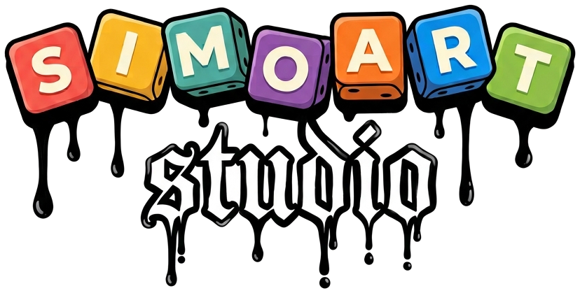

<div align="center">



# SimoArt studio

Strona studia projektowania i programowania stron, sklepów internetowych i aplikacji.

[](https://github.com/kameleon1312/szymon-studio/actions/workflows/ci.yml)


**[sp-flow.vercel.app](https://sp-flow.vercel.app)**

</div>

---

## O projekcie

Strona prezentuje realizacje i ofertę studia oraz prowadzi odwiedzającego do kontaktu. Każda sekcja
opowiada część procesu: od pomysłu, przez projekt, po wdrożenie.

| Sekcja | Opis |
|---|---|
| **Hero** | animowana kostka z logo, nagłówek i dwa wezwania do działania |
| **Wybrane projekty** | kafelki realizacji z podglądem na urządzeniach; każdy projekt ma własne case study (`/works/[slug]`) |
| **Co chcesz zbudować?** | interaktywny wybór typu projektu z przykładem z portfolio |
| **Tak powstaje strona** | makieta strony budowana etapami: siatka, układ, typografia, kolor, interakcja, responsywność |
| **Zasady i proces** | trzy zasady współpracy i cztery etapy pracy z efektem każdego z nich |
| **Miło Cię poznać** | naklejka z logo pod szklaną pokrywą, odsłaniana przewijaniem lub kliknięciem |
| **Kontakt** | formularz z załącznikiem, wysyłany przez Server Action |

## Najważniejsze cechy

- **Wydajność** — animacje wyłącznie na `transform` i `opacity` (warstwa kompozytora), `content-visibility`
  dla sekcji poniżej ekranu, Framer Motion ładowany przez `LazyMotion`, font z polskimi znakami 5 KB.
- **Dostępność** — testy axe (WCAG 2.2 AA) dla desktopu i mobile, pełna obsługa klawiaturą,
  cele dotyku min. 44 px, wsparcie `prefers-reduced-motion`, treść dostępna bez JavaScriptu.
- **Bezpieczeństwo** — ścisła polityka CSP i nagłówki bezpieczeństwa, walidacja formularza po stronie
  serwera (Zod), weryfikacja załącznika po zawartości, limit wiadomości per IP, `security.txt`.
- **SEO** — metadane i obrazy Open Graph generowane dla każdej strony, dane strukturalne (JSON-LD),
  sitemap i `robots.txt`; wdrożenia preview są wyłączone z indeksowania.

## Stack

| Obszar | Technologie |
|---|---|
| Framework | Next.js 16 (App Router), React 19, TypeScript |
| Style | SCSS Modules |
| Animacje | Framer Motion, Web Animations API, CSS `@property` |
| Formularz | Server Actions, Zod, Nodemailer (Gmail SMTP) |
| Testy | Playwright, axe-core |
| Infrastruktura | Vercel (region `fra1`), GitHub Actions, Dependabot, gitleaks |

## Uruchomienie lokalne

Wymagany **Node.js 22**.

```bash
git clone https://github.com/kameleon1312/szymon-studio.git
cd szymon-studio
npm ci
cp .env.example .env.local   # uzupełnij, jeśli formularz ma wysyłać wiadomości
npm run dev                  # http://localhost:3000
```

### Skrypty

| Polecenie | Działanie |
|---|---|
| `npm run dev` | serwer deweloperski |
| `npm run build` | walidacja zmiennych środowiskowych i build produkcyjny |
| `npm start` | uruchomienie zbudowanej wersji |
| `npm run typecheck` | sprawdzenie typów TypeScript |
| `npm run lint` | ESLint |
| `npm test` | testy jednostkowe i E2E (desktop + mobile) |
| `npm run test:smoke` | testy dymne tylko do odczytu (bezpieczne na produkcji) |
| `npm run projects` | odświeżenie danych projektów z GitHub API |

## Zmienne środowiskowe

Pełny opis w [`.env.example`](.env.example).

| Zmienna | Wymagana | Opis |
|---|---|---|
| `GMAIL_USER` | tak (produkcja) | skrzynka odbierająca wiadomości z formularza |
| `GMAIL_APP_PASSWORD` | tak (produkcja) | hasło aplikacji Google (nie hasło do konta) |
| `NEXT_PUBLIC_SITE_URL` | nie | docelowa domena; domyślnie adres produkcyjny Vercel |
| `GITHUB_TOKEN` | nie | token tylko do odczytu — dane prywatnych repozytoriów w portfolio |

## Struktura

```text
src/
├── app/                 # trasy App Router, metadane, obrazy OG, robots, sitemap
│   ├── works/           # lista projektów i case study (/works/[slug])
│   ├── actions/         # Server Action formularza kontaktowego
│   └── polityka-prywatnosci/
├── components/
│   ├── hybrid/          # sekcje strony głównej (hero, szkło, maskotki)
│   ├── sections/        # projekty, wybór projektu, proces, kontakt
│   └── concept/         # makieta „Tak powstaje strona”
├── data/                # konfiguracja marki, dane i nadpisania projektów
├── lib/                 # schematy, metadane, logika serwerowa
└── styles/              # tokeny, mixiny, style globalne
tests/                   # Playwright: unit, E2E, dostępność, smoke
scripts/                 # walidacja env, pobieranie danych z GitHuba, generowanie ikon
docs/                    # architektura, runbook, RODO, plan incydentów
```

## Projekty w portfolio

Dane projektów pochodzą z dwóch plików scalanych w `src/lib/projects.ts`:

- `src/data/projects.json` — generowany przez `npm run projects` z GitHub API (nie edytuj ręcznie),
- `src/data/projects.overrides.json` — kolejność, opisy, statusy, case study i zrzuty ekranu; **ma pierwszeństwo**.

**Nowy projekt:** dopisz repozytorium do `order` i wpis do `projects` w pliku nadpisań, dodaj zrzuty
ekranu w WebP do `public/projects/<slug>/`, następnie uruchom `npm run projects`. Gdy GitHub API jest
niedostępne, zostają ostatnie poprawne dane — build nie zatrzymuje się z tego powodu.

## Jakość i CI

Każdy push i pull request przechodzi przez pipeline GitHub Actions:
typecheck → lint → audyt zależności produkcyjnych → build → testy Playwright → SBOM → skan sekretów (gitleaks).
Po każdym wdrożeniu produkcyjnym i co 6 godzin workflow „Smoke” sprawdza działającą stronę.

## Wdrożenie

Gałąź `main` wdraża się automatycznie na produkcję Vercel, pozostałe gałęzie i pull requesty — jako preview.
Konfiguracja, domena i lista kontrolna: [`DEPLOY.md`](DEPLOY.md). Procedury operacyjne:
[`docs/RUNBOOK.md`](docs/RUNBOOK.md).

## Autor

**Szymon Pochopień** — SimoArt studio
[GitHub](https://github.com/kameleon1312) · [LinkedIn](https://linkedin.com/in/szymon-pochopien) · [szymon.pochopien01@gmail.com](mailto:szymon.pochopien01@gmail.com)

© 2026 SimoArt studio. Wszelkie prawa zastrzeżone.
