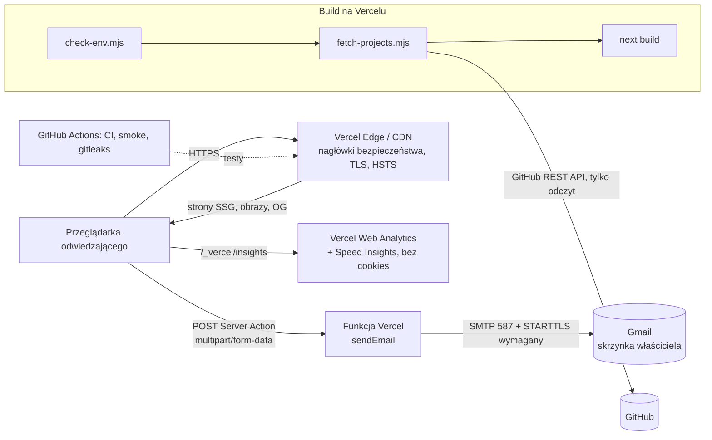

# Architektura — SimoArt studio (portfolio)

Statyczna strona portfolio z jednym dynamicznym elementem: formularzem kontaktowym, który wysyła e-mail.

## Diagram

Granice zaufania: przeglądarka → funkcja Vercel (każde pole formularza jest niezaufane) · funkcja → Gmail (sekret `GMAIL_APP_PASSWORD`) · build → GitHub API (opcjonalny token tylko do odczytu).

## Komponenty

| Komponent | Technologia | Gdzie |
|---|---|---|
| Strony | Next.js 16 App Router, wszystkie trasy SSG | `src/app` |
| Formularz (klient) | React, walidacja tym samym schematem co serwer (ładowany przy wysyłce) | `src/components/ContactForm`, `src/lib/contactSchema.ts` |
| Formularz (serwer) | Server Action `sendEmail` | `src/app/actions/sendEmail.ts` |
| Logika serwerowa | sygnatury plików, limiter, logi, konfiguracja | `src/lib/server/` |
| Dane projektów | `projects.json` (generowany) + `projects.overrides.json` (ręczne) | `src/data`, `scripts/fetch-projects.mjs` |
| Konfiguracja HTTP | CSP i nagłówki bezpieczeństwa | `next.config.js` |

## Inwentarz endpointów

| Endpoint | Metoda | Dostęp | Dane wejściowe | Uwagi |
|---|---|---|---|---|
| `/`, `/works`, `/works/[slug]`, `/polityka-prywatnosci` | GET | publiczny | — | SSG; nieznany slug → 404 |
| Server Action `sendEmail` (POST na `/` z nagłówkiem `Next-Action`) | POST | publiczny (świadomie) | pola formularza, 1 załącznik ≤ 4 MB | walidacja Zod, sygnatura pliku, limit per IP, weryfikacja `Origin` (Next.js) |
| `/opengraph-image`, `/twitter-image`, `/works/[slug]/opengraph-image` itd. | GET | publiczny | slug z allow-listy (`dynamicParams = false`) | generowane przy buildzie |
| `/apple-icon`, `/robots.txt`, `/sitemap.xml`, `/.well-known/security.txt` | GET | publiczny | — | statyczne |

Brak tras API (`route.ts`), middleware, kont i bazy danych.

## Threat model formularza (STRIDE)

| Zagrożenie | Scenariusz | Kontrola |
|---|---|---|
| Spoofing | Podszycie się pod nadawcę w `Reply-To` | Adres tylko z walidacji (bez `,;<>`), nagłówki kodowane przez nodemailer |
| Tampering | Wartości spoza listy, wstrzyknięcie HTML/CRLF | Schemat Zod (allow-listy), `esc()` w treści HTML, test CRLF |
| Repudiation | Brak śladu nadużyć | Logi JSON z numerem zgłoszenia (`ref`) bez danych osobowych |
| Information disclosure | Wyciek hasła SMTP | Sekret tylko w zmiennych Vercel, moduły `server-only`, `requireTLS`, brak source map |
| Denial of service | Zalew wiadomości, duże pliki, limit Gmaila | Limit 3/10 min i 10/dzień per IP, 100/dzień na instancję, body ≤ 4,5 MB, timeouty SMTP 10 s |
| Elevation of privilege | Złośliwy załącznik u właściciela | Allow-lista typów, weryfikacja magic bytes + rozszerzenia, skan antywirusowy Gmaila |

Ryzyka resztkowe: limiter działa w pamięci instancji (rekomendowana reguła Vercel Firewall — [RUNBOOK](RUNBOOK.md#rate-limiting)); brak CAPTCHA.

## Ciągłość działania

| Zasób | Dane krytyczne? | RPO | RTO | Odtworzenie |
|---|---|---|---|---|
| Aplikacja (kod, treść, obrazy) | nie (wszystko w git) | 0 — każdy commit | ≤ 15 min | Instant Rollback lub ponowne wdrożenie z GitHuba ([RUNBOOK](RUNBOOK.md#rollback)) |
| Zapytania klientów (Gmail) | tak | zależne od Google | — | poza aplikacją; kopia: Google Takeout raz na kwartał |
| Konfiguracja Vercel (env, domeny) | tak | — | ≤ 30 min | lista zmiennych w `.env.example`, kroki w `DEPLOY.md` |

## Limity platform

| Usługa | Limit | Skutek przekroczenia |
|---|---|---|
| Gmail SMTP (konto prywatne) | ok. 500 odbiorców / dobę | formularz zwraca błąd do końca doby |
| Vercel (plan Hobby) | limity wywołań funkcji, transferu i retencji logów (krótka) | błędy 429/503, brak historycznych logów |
| GitHub Actions (repo prywatne) | 2000 min/mies. | wstrzymanie CI — smoke co 6 h zużywa ok. 120–240 min/mies. |
